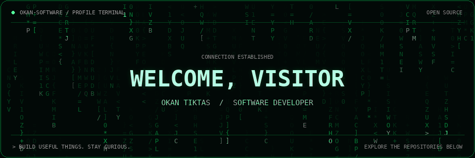

**I build tools for those “there has to be an easier way” moments.**

I’m Okan Tiktas, and here’s what I’ve been working on:

🔐 **[VeilDrop](https://github.com/OKAN-SOFTWARE/veildrop)** — Helps redact sensitive information from logs and text before sharing, with encrypted handoffs.

🚀 **[LaunchNotes](https://github.com/OKAN-SOFTWARE/LaunchNotes)** — Turns commit messages into readable release notes. Because “fixed stuff” deserves a better launch announcement.

📄 **[Doc2FAQ](https://github.com/OKAN-SOFTWARE/Doc2FAQ)** — Turns documents into editable FAQ drafts, with local processing and export options.

I’m building, learning, and contributing fixes to open source along the way. Try a project, challenge an assumption, or open an issue—your feedback helps shape what comes next.

My favorite review would be: “This saved me time.”

If something earns that reaction, leave it a ⭐ so the next developer can find it too.

### 🛠 Technologies

### 🌱 Currently Learning

AWS cloud optimization, AI token efficiency, and serverless development.
