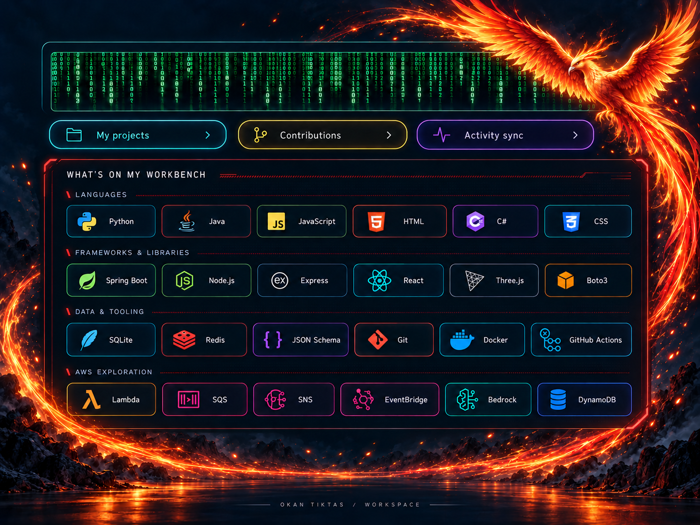
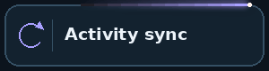
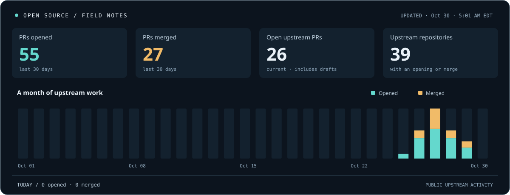

  

  
  
  

<!-- PROFILE-BADGES:START -->

  
  
  
  
  

<!-- PROFILE-BADGES:END -->

I’m **Okan Tiktas**. I build tools for those **“there has to be an easier way”** moments—and contribute fixes to the tools other developers depend on.

My open-source work usually starts with a bug I can reproduce. I trace it, make a focused change, add a regression test, and work through review. My forks are the workbench; the pull requests below show what I’ve sent upstream.

## Open Source Field Notes

<!-- ACTIVITY:START -->

**Sep 29–Oct 28, 2026** · **Last profile update: Oct 28, 2026 at 9:00 AM EDT**

**38 opened · 18 merged · 19 open now · 27 upstream repositories**

### Latest upstream work

| State | Contribution | Repository |
| :--- | :--- | :--- |
| 🟢 Open | [fix(prompt-engine): prevent duplicate nested architectural decisions · #203](https://github.com/PicadoLabs/build-with-ai/pull/203) | [PicadoLabs/build-with-ai](https://github.com/PicadoLabs/build-with-ai) |
| 🟢 Open | [fix(rules): prevent duplicate deployment platform in exports · #202](https://github.com/PicadoLabs/build-with-ai/pull/202) | [PicadoLabs/build-with-ai](https://github.com/PicadoLabs/build-with-ai) |
| 🟢 Open | [test: isolate profile validation tests from user language settings · #28](https://github.com/ftery0/ai-profile-switch/pull/28) | [ftery0/ai-profile-switch](https://github.com/ftery0/ai-profile-switch) |
|  Merged | [fix: protect tabs with unsaved form changes · #21](https://github.com/theluckystrike/tab-suspender-chrome-extension/pull/21) | [theluckystrike/tab-suspender-chrome-extension](https://github.com/theluckystrike/tab-suspender-chrome-extension) |
| 🟢 Open | [Clarify supported random seed types in dataset helpers (NumPy-compatible random seeds for dataset helpers) · #520](https://github.com/mne-tools/mne-connectivity/pull/520) | [mne-tools/mne-connectivity](https://github.com/mne-tools/mne-connectivity) |
| 🟢 Open | [fix(cli): handle output write failures consistently · #4](https://github.com/veerjain-1/agent-guard-eval/pull/4) | [veerjain-1/agent-guard-eval](https://github.com/veerjain-1/agent-guard-eval) |
| 🟢 Open | [fix(dynamodb): resolve service manager mypy errors · #9](https://github.com/manojkken/testcontainers-aws/pull/9) | [manojkken/testcontainers-aws](https://github.com/manojkken/testcontainers-aws) |
| 🟢 Open | [fix(server): exit with an error when PORT is invalid · #797](https://github.com/jannskiee/floe/pull/797) | [jannskiee/floe](https://github.com/jannskiee/floe) |
|  Merged | [fix(artifact-record): prevent output from replacing source evidence · #178](https://github.com/lostlight530/auto-doc-engine/pull/178) | [lostlight530/auto-doc-engine](https://github.com/lostlight530/auto-doc-engine) |
| 🟢 Open | [fix(core): make generator output ordering deterministic · #1193](https://github.com/nodejs/doc-kit/pull/1193) | [nodejs/doc-kit](https://github.com/nodejs/doc-kit) |

[Explore all upstream contributions →](https://github.com/pulls?q=is%3Apr+is%3Apublic+author%3AOKAN-SOFTWARE+-user%3AOKAN-SOFTWARE+sort%3Aupdated-desc)

The chart records PR openings and merges—not commits or fork creation. The open count includes drafts across all dates. Private work and my own repositories are excluded. Counts do not imply approval or passing CI. [How this updates](./PROFILE.md)

<!-- ACTIVITY:SNAPSHOT:3b998c8acbc0f9d895bf32ec6f8a14b6f40e40be8120c887f591eafe93dadca0 -->
<!-- ACTIVITY:END -->

## Built from an everyday problem

| Project | The moment it helps |
| :--- | :--- |
| **[VeilDrop](https://github.com/OKAN-SOFTWARE/veildrop)** | “I need to share this log without sharing its secrets.” Local text redaction and encrypted handoffs. |
| **[LaunchNotes](https://github.com/OKAN-SOFTWARE/LaunchNotes)** | “These commits need a better story than ‘fixed stuff.’” Turn commit messages into readable release notes. |
| **[Doc2FAQ](https://github.com/OKAN-SOFTWARE/Doc2FAQ)** | “The answers are in this document somewhere.” Turn documents into editable FAQ drafts, with local processing and exports. |

## What’s on my workbench

Explore the stack

| Area | Technologies |
| :--- | :--- |
| **Languages** | Python · Java · JavaScript · C# · HTML · CSS · SQL |
| **Frameworks** | Spring Boot · Node.js · Express · React · Three.js |
| **Data & tools** | SQLite · Redis · JSON Schema · REST APIs · Git · GitHub Actions · Docker |
| **Testing & libraries** | pytest · JUnit · Vitest · Boto3 · PDFBox · Apache POI |
| **AWS exploration** | Lambda · SQS · SNS · EventBridge · Bedrock · DynamoDB |
| **Learning path** | Cloud optimization · Serverless development · AI token efficiency |

Tools used across personal projects and contribution work; AWS topics include ongoing learning.

---

**My favorite review: “This saved me time.”**  
Try a project, report a rough edge, or challenge an assumption. That’s how the next useful version starts.

