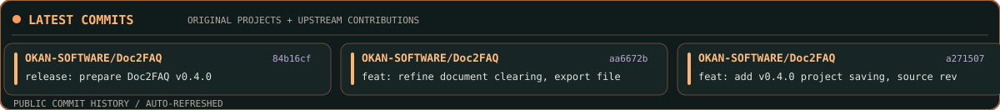
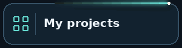
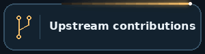
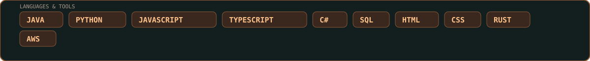

  

Public authored commits, refreshed automatically · <a href="https://github.com/search?q=author%3AOKAN-SOFTWARE&type=commits">Browse commits on GitHub</a>

  
  

  
  

<h2 align="center">Building software that solves real problems.</h2>

I'm <strong>Okan Tiktas</strong>, a software engineer focused on backend services, web applications, automation, developer tooling, and open-source contributions. I enjoy turning a recurring problem into a dependable tool, reproducing difficult bugs, and adding tests that keep them fixed.

  

## Tools built around real needs

<!-- SHOWCASE:START -->
_The six most recently updated original public repositories will appear here automatically._
<!-- SHOWCASE:END -->

## Open Source Field Notes

I contribute focused fixes, regression tests, CI improvements, and documentation updates to upstream repositories. These are real public pull requests, with separate counts for opened and merged work.

<!-- ACTIVITY:START -->
**Last profile update: Oct 30, 2026 at 9:08 PM EDT**

**61 opened · 27 merged · 31 open now · 44 upstream repositories**

### Latest upstream work

| State | Contribution | Repository |
| :--- | :--- | :--- |
| 🟢 Open | [fix(builder): close source stream after decoding error (#3404) · #3459](https://github.com/pylint-dev/astroid/pull/3459) | [pylint-dev/astroid](https://github.com/pylint-dev/astroid) |
| 🟢 Open | [fix(win32): correct SetCursorPos argument types (#1745) · #1750](https://github.com/java-native-access/jna/pull/1750) | [java-native-access/jna](https://github.com/java-native-access/jna) |
| 🟢 Open | [fix(mysql): reset popped state when re-pushing queue messages (#1777) · #1784](https://github.com/conductor-oss/conductor/pull/1784) | [conductor-oss/conductor](https://github.com/conductor-oss/conductor) |
| 🟢 Open | [fix(html): exclude custom bundler from worker configuration · #1204](https://github.com/nodejs/doc-kit/pull/1204) | [nodejs/doc-kit](https://github.com/nodejs/doc-kit) |
| 🟢 Open | [fix(client): support accountId in assignable project searches · #2449](https://github.com/pycontribs/jira/pull/2449) | [pycontribs/jira](https://github.com/pycontribs/jira) |
| 🟢 Open | [test: isolate Django cache settings between xdist worker groups · #852](https://github.com/jazzband/django-redis/pull/852) | [jazzband/django-redis](https://github.com/jazzband/django-redis) |
| 🟢 Open | [fix: avoid stale dependency comparisons during snapshot retries · #1179](https://github.com/actions/dependency-review-action/pull/1179) | [actions/dependency-review-action](https://github.com/actions/dependency-review-action) |
| 🟢 Open | [fix: improve diagnostics for missing Linux libraries · #1656](https://github.com/actions/setup-node/pull/1656) | [actions/setup-node](https://github.com/actions/setup-node) |
| 🟢 Open | [fix(watch): refresh remote status after terminal git push · #1044](https://github.com/JetBrains/thinkrail/pull/1044) | [JetBrains/thinkrail](https://github.com/JetBrains/thinkrail) |
| 🟣 Merged | [feat(cli): add machine-readable JSON dry-run output (#17) · #27](https://github.com/javvadivijayprasad/sel2pw/pull/27) | [javvadivijayprasad/sel2pw](https://github.com/javvadivijayprasad/sel2pw) |

[Explore open upstream PRs →](https://github.com/pulls?q=is%3Apr+is%3Apublic+author%3AOKAN-SOFTWARE+-user%3AOKAN-SOFTWARE+is%3Aopen+sort%3Aupdated-desc) · [Merged upstream PRs →](https://github.com/pulls?q=is%3Apr+is%3Apublic+author%3AOKAN-SOFTWARE+-user%3AOKAN-SOFTWARE+is%3Amerged+sort%3Aupdated-desc)

The upstream counters record PR openings and merges—not commits or fork creation. The open count includes drafts across all dates. Private work and my own repositories are excluded. Counts do not imply approval or passing CI. [How this updates](./PROFILE.md)

<!-- ACTIVITY:SNAPSHOT:1b051f95db01950162de2e9eced2a16823d528352a7007461903da4f0166bfb6 -->
<!-- ACTIVITY:END -->

<strong>How these contribution statistics are counted</strong>

The counters track upstream PR openings and merges, not commits or forks. The open count includes drafts. Private work and my own repositories are excluded. A submitted PR does not imply approval or passing CI. [How this updates](./PROFILE.md).

## Recent Activity

*Auto-checked every hour with GitHub Actions · latest public action per repository · timestamps hidden for a cleaner view.*

<!-- RECENT:START -->
| Recent activity | Details |
| :--- | :--- |
| Opened PR in [pylint-dev/astroid](https://github.com/pylint-dev/astroid) | [Pull request](https://github.com/pylint-dev/astroid/pull/3459) |
| Opened PR in [OKAN-SOFTWARE/OKAN-SOFTWARE](https://github.com/OKAN-SOFTWARE/OKAN-SOFTWARE) | [Pull request](https://github.com/OKAN-SOFTWARE/OKAN-SOFTWARE/pull/17) |
| Opened PR in [java-native-access/jna](https://github.com/java-native-access/jna) | [Pull request](https://github.com/java-native-access/jna/pull/1750) |
| Opened PR in [conductor-oss/conductor](https://github.com/conductor-oss/conductor) | [Pull request](https://github.com/conductor-oss/conductor/pull/1784) |
| Commented in [nodejs/doc-kit](https://github.com/nodejs/doc-kit) | [fix\(html\): exclude custom bundler from worker configuration](https://github.com/nodejs/doc-kit/issues/1204) |
| Commented in [vitest-dev/vitest](https://github.com/vitest-dev/vitest) | [fix\(vitest\): resolve dependencies from project root](https://github.com/vitest-dev/vitest/issues/11805) |
| Forked repository in [celery/kombu](https://github.com/celery/kombu) | Public fork |
| Opened PR in [pycontribs/jira](https://github.com/pycontribs/jira) | [Pull request](https://github.com/pycontribs/jira/pull/2449) |
<!-- RECENT:END -->

<strong>Code DNA, commit patterns &amp; full development stack</strong>

<!-- JOURNEY:START -->
**Developer stats refreshed:** Oct 30, 2026 at 09:08 PM EDT

### 🧬 Code DNA · Public GitHub History

**80 authored commits · 9 public original repositories**

#### 🕒 When I Commit

| Time of day (Eastern) | Commits | Share | Activity |
| :--- | ---: | ---: | :--- |
| 🌞 Morning | 38 | 47.5% | ████████░░░░░░░░ |
| 🌆 Daytime | 37 | 46.2% | ███████░░░░░░░░░ |
| 🌃 Evening | 5 | 6.2% | █░░░░░░░░░░░░░░░ |
| 🌙 Night | 0 | 0.0% | ░░░░░░░░░░░░░░░░ |

#### 💬 I Mostly Code in JavaScript

| Language | Line of Codes | Source bytes | Activity |
| :--- | ---: | ---: | :--- |
| JavaScript | 273,411 | 16,944,094 | ████████████████ |
| Java | 1,603 | 81,259 | ░░░░░░░░░░░░░░░░ |
| Python | 1,377 | 68,902 | ░░░░░░░░░░░░░░░░ |
| HTML | 731 | 51,076 | ░░░░░░░░░░░░░░░░ |
| TypeScript | 1,128 | 12,729 | ░░░░░░░░░░░░░░░░ |
| Rust | 44 | 2,148 | ░░░░░░░░░░░░░░░░ |
| Dockerfile | 9 | 351 | ░░░░░░░░░░░░░░░░ |

### 🧩 My Development Stack

| Area | Technologies |
| :--- | :--- |
| **Backend** | Java · Python · C# · JavaScript/TypeScript (Node.js) · Express · Spring Boot |
| **Frontend** | JavaScript · TypeScript · React · HTML · CSS · Three.js |
| **Data & SQL** | SQL · PostgreSQL · SQL Server · SQLite · MongoDB · DynamoDB |
| **OS & DevOps** | Windows · Ubuntu/WSL · GitHub Actions · Docker |
| **Cloud** | AWS Lambda · SQS · SNS · EventBridge · EC2 |
<!-- JOURNEY:END -->

## 🐍 Contribution Snake

  <picture>
    <source media="(prefers-color-scheme: dark)" srcset="./assets/contribution-snake-dark.svg" />
    <source media="(prefers-color-scheme: light)" srcset="./assets/contribution-snake.svg" />
    
  </picture>

The animated snake follows my public GitHub contribution calendar and refreshes daily. Coding statistics above remain selectable text.

  

