<!-- GITHUB-COMPATIBLE MATRIX DESIGN · No JavaScript or custom CSS in README -->

  <a href="https://github.com/search?q=author%3AOKAN-SOFTWARE&type=commits">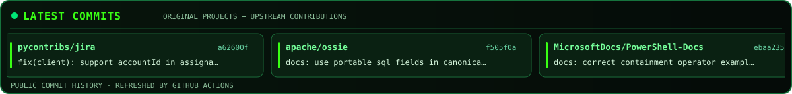</a>

  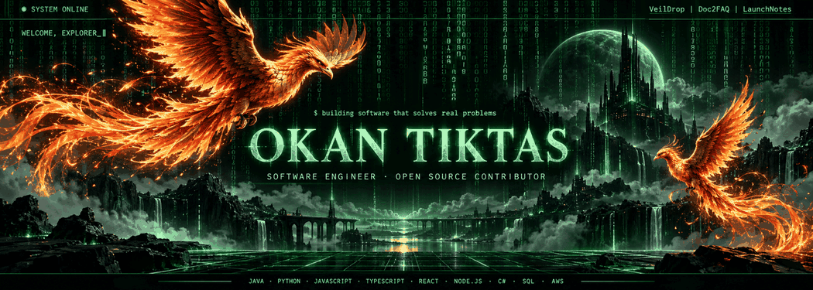

## Contribution Snake

  <picture>
    <source media="(prefers-color-scheme: dark)" srcset="./assets/contribution-snake-dark.svg" />
    <source media="(prefers-color-scheme: light)" srcset="./assets/contribution-snake.svg" />
    
  </picture>

The snake is generated daily from public contributions and uses Matrix-green animated SVGs.

---

## About

<table>
<tr>
<td width="60%" valign="middle">
  <h2>Building software that <em>solves real problems.</em></h2>
  
I develop practical backend systems, web applications, automation, and developer tools—turning everyday challenges into software people can rely on.

  
I enjoy tracking down stubborn bugs, simplifying repetitive work, and writing regression tests that make improvements stick. I bring that same approach to my own projects and open-source contributions.

  
<strong>Build → Test → Improve → Contribute.</strong>

</td>
<td width="40%" valign="middle">
  
</td>
</tr>
</table>

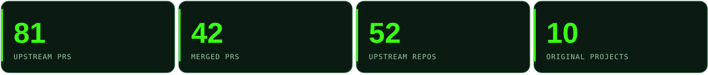

## Tools built around real needs

Practical projects I built and maintain, ordered by **most recently updated**. These are **my original repositories**, not forks.

<!-- MATRIX_PROJECTS:START -->
Automatically sorted by latest push · Original public repositories only · Up to three source languages per card

| | |
| :--- | :--- |
| <a href="https://github.com/OKAN-SOFTWARE/DriveBench">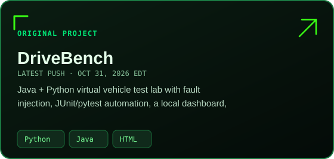</a> | <a href="https://github.com/OKAN-SOFTWARE/Doc2FAQ">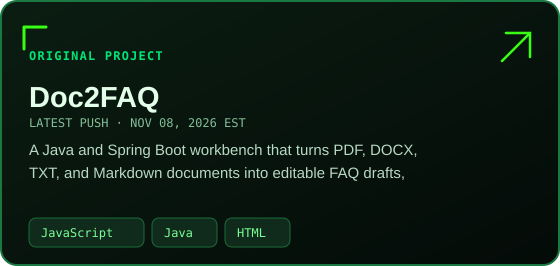</a> |
| <a href="https://github.com/OKAN-SOFTWARE/mole-meadow">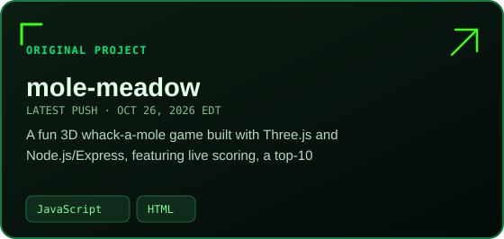</a> | <a href="https://github.com/OKAN-SOFTWARE/TokenWise">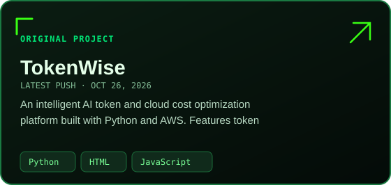</a> |
| <a href="https://github.com/OKAN-SOFTWARE/LaunchNotes">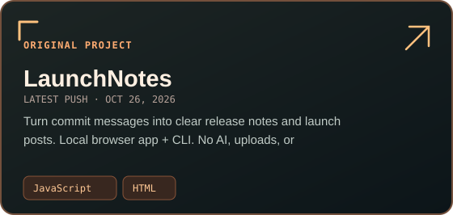</a> | <a href="https://github.com/OKAN-SOFTWARE/Python-CLI-App">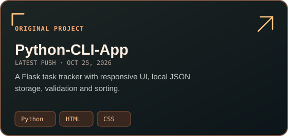</a> |

<a href="https://github.com/OKAN-SOFTWARE?tab=repositories"><strong>Browse all original projects ↗</strong></a>

<!-- MATRIX_PROJECTS:END -->

## Open Source Field Notes

I contribute focused bug fixes, regression tests, CI improvements, and documentation to upstream projects. The counts below distinguish PRs opened, merged, and still under review.

<!-- ACTIVITY:START -->
**Last profile update: Nov 04, 2026 at 9:19 PM EST**

**80 opened · 37 merged · 37 open now · 52 upstream repositories**

### Latest upstream work

| State | Contribution | Repository |
| :--- | :--- | :--- |
| 🟣 Merged | [Update Appx manifest to not allow updates while PS7 is running · #28275](https://github.com/PowerShell/PowerShell/pull/28275) | [PowerShell/PowerShell](https://github.com/PowerShell/PowerShell) |
| 🟢 Open | [fix(code-executors): preserve hard-linked output files (#7906) · #7932](https://github.com/google/adk-python/pull/7932) | [google/adk-python](https://github.com/google/adk-python) |
| 🟢 Open | [Fix TS1450 diagnostic severity for invalid dynamic imports · #65317](https://github.com/microsoft/TypeScript/pull/65317) | [microsoft/TypeScript](https://github.com/microsoft/TypeScript) |
| 🟢 Open | [Fix ARM NEON VQABS and VQNEG instruction decoding · #10114](https://github.com/NationalSecurityAgency/ghidra/pull/10114) | [NationalSecurityAgency/ghidra](https://github.com/NationalSecurityAgency/ghidra) |
| 🟣 Merged | [fix(client): support accountId in assignable project searches · #2449](https://github.com/pycontribs/jira/pull/2449) | [pycontribs/jira](https://github.com/pycontribs/jira) |
| 🟢 Open | [fix(html): exclude custom bundler from worker configuration · #1204](https://github.com/nodejs/doc-kit/pull/1204) | [nodejs/doc-kit](https://github.com/nodejs/doc-kit) |
| 🟣 Merged | [docs: use portable sql fields in canonical examples · #640](https://github.com/apache/ossie/pull/640) | [apache/ossie](https://github.com/apache/ossie) |
| 🟢 Open | [fix(E2002): reject misspelled parameter types in wrappers · #4935](https://github.com/aws-cloudformation/cfn-lint/pull/4935) | [aws-cloudformation/cfn-lint](https://github.com/aws-cloudformation/cfn-lint) |
| 🟢 Open | [fix(mysql): reset popped state when re-pushing queue messages (#1777) · #1784](https://github.com/conductor-oss/conductor/pull/1784) | [conductor-oss/conductor](https://github.com/conductor-oss/conductor) |
| 🟢 Open | [Clarify ScriptBlock support in ConstrainedLanguage mode · #13370](https://github.com/MicrosoftDocs/PowerShell-Docs/pull/13370) | [MicrosoftDocs/PowerShell-Docs](https://github.com/MicrosoftDocs/PowerShell-Docs) |

[Explore open upstream PRs →](https://github.com/pulls?q=is%3Apr+is%3Apublic+author%3AOKAN-SOFTWARE+-user%3AOKAN-SOFTWARE+is%3Aopen+sort%3Aupdated-desc) · [Merged upstream PRs →](https://github.com/pulls?q=is%3Apr+is%3Apublic+author%3AOKAN-SOFTWARE+-user%3AOKAN-SOFTWARE+is%3Amerged+sort%3Aupdated-desc)

The upstream counters record PR openings and merges—not commits or fork creation. The open count includes drafts across all dates. Private work and my own repositories are excluded. Counts do not imply approval or passing CI. [How this updates](./PROFILE.md)

<!-- ACTIVITY:SNAPSHOT:b359c67576abcdc8ace2fe8a53ab7eb627cc5a6c2f4f62ba7e79880806f5bb9b -->
<!-- ACTIVITY:END -->

## Recent Activity

Automatically refreshed · Latest public action per repository · No timestamp column

<!-- RECENT:START -->
| Recent activity | Details |
| :--- | :--- |
| Commented in [google/adk-python](https://github.com/google/adk-python) | [fix\(code-executors\): preserve hard-linked output files \(#7906\)](https://github.com/google/adk-python/issues/7932) |
| Commented in [NationalSecurityAgency/ghidra](https://github.com/NationalSecurityAgency/ghidra) | [Fix ARM NEON VQABS and VQNEG instruction decoding](https://github.com/NationalSecurityAgency/ghidra/issues/10114) |
| Opened PR in [microsoft/TypeScript](https://github.com/microsoft/TypeScript) | [Pull request](https://github.com/microsoft/TypeScript/pull/65317) |
| Commented in [kubernetes-client/python](https://github.com/kubernetes-client/python) | [InClusterConfigLoader token refresh uses timezone-naive datetime.now\(\), stalls on backward clock jumps \(DST\)](https://github.com/kubernetes-client/python/issues/2768) |
| Commented in [aws-cloudformation/cfn-lint](https://github.com/aws-cloudformation/cfn-lint) | [fix\(E2002\): report lists of SSM parameter types as errors](https://github.com/aws-cloudformation/cfn-lint/issues/4928) |
| Commented in [fabric8io/kubernetes-client](https://github.com/fabric8io/kubernetes-client) | [Add a global default bind address for port-forward listeners](https://github.com/fabric8io/kubernetes-client/issues/7968) |
| Commented in [psf/requests](https://github.com/psf/requests) | [Fix: Respect no\_proxy in proxies dictionary and NO\_PROXY env var](https://github.com/psf/requests/issues/7068) |
| Pushed code in [OKAN-SOFTWARE/PowerShell-Docs](https://github.com/OKAN-SOFTWARE/PowerShell-Docs) | Branch docs/13337-scriptblock-language-modes |
<!-- RECENT:END -->

## Languages & Toolkit

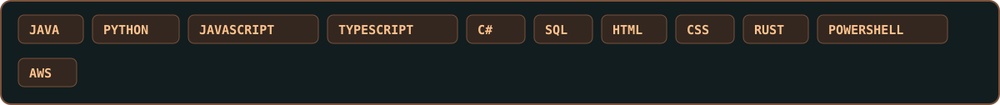

| Focus | Technologies |
| :--- | :--- |
| **Backend** | Java · Python · C# · JavaScript/TypeScript · Node.js · Express · Spring Boot |
| **Frontend** | React · JavaScript · TypeScript · HTML · CSS · Three.js |
| **Data** | SQL · PostgreSQL · SQL Server · SQLite · MongoDB · DynamoDB |
| **Cloud & delivery** | AWS Lambda · SQS · SNS · EventBridge · EC2 · GitHub Actions · Docker |
| **Testing** | pytest · JUnit · Vitest · automated regression testing |

<!-- CODE_MATRIX:START -->
### 🟢 OKAN'S CODE STATS // LIVE UPDATES

**TOTAL LINES OF CODE: 9,019**

| Language | Lines | Share | Distribution |
| :--- | ---: | ---: | :--- |
|  **JavaScript** | 3,275 | **36.31%** | 🟩🟩🟩🟩⬛⬛⬛⬛⬛⬛⬛⬛ |
|  **Python** | 2,607 | **28.91%** | 🟩🟩🟩⬛⬛⬛⬛⬛⬛⬛⬛⬛ |
|  **Java** | 1,958 | **21.71%** | 🟩🟩🟩⬛⬛⬛⬛⬛⬛⬛⬛⬛ |
|  **HTML** | 765 | **8.48%** | 🟩⬛⬛⬛⬛⬛⬛⬛⬛⬛⬛⬛ |
|  **TypeScript** | 160 | **1.77%** | 🟩⬛⬛⬛⬛⬛⬛⬛⬛⬛⬛⬛ |
|  **CSS** | 107 | **1.19%** | 🟩⬛⬛⬛⬛⬛⬛⬛⬛⬛⬛⬛ |
|  **XML** | 94 | **1.04%** | 🟩⬛⬛⬛⬛⬛⬛⬛⬛⬛⬛⬛ |
|  **Rust** | 44 | **0.49%** | 🟩⬛⬛⬛⬛⬛⬛⬛⬛⬛⬛⬛ |
|  **Dockerfile** | 9 | **0.10%** | 🟩⬛⬛⬛⬛⬛⬛⬛⬛⬛⬛⬛ |

Automatically checked every 15 minutes · Public original repositories · Nonblank source lines (including comments) · Dependencies, generated files, and binaries excluded · Tiny nonzero shares show one green cell
<!-- ORIGINAL_REPOS:10 -->
<!-- CODE_MATRIX:END -->

<!-- UPSTREAM_CODE:START -->
### 🟢 UPSTREAM CONTRIBUTIONS // MERGED PRS

**37 merged PRs** · **+3,647 lines added** · **−858 lines removed**

| Upstream repository | Merged pull request | Added | Removed | Languages / Frameworks |
| :--- | :--- | ---: | ---: | :--- |
| [pycontribs/jira](https://github.com/pycontribs/jira) | [#2449](https://github.com/pycontribs/jira/pull/2449) | +78 | −4 | Python |
| [apache/ossie](https://github.com/apache/ossie) | [#640](https://github.com/apache/ossie/pull/640) | +181 | −522 | Documentation / other |
| [MicrosoftDocs/PowerShell-Docs](https://github.com/MicrosoftDocs/PowerShell-Docs) | [#13359](https://github.com/MicrosoftDocs/PowerShell-Docs/pull/13359) | +12 | −12 | Documentation / other |
| [PicadoLabs/build-with-ai](https://github.com/PicadoLabs/build-with-ai) | [#226](https://github.com/PicadoLabs/build-with-ai/pull/226) | +50 | −2 | JavaScript |
| [FasterXML/jackson-databind](https://github.com/FasterXML/jackson-databind) | [#6362](https://github.com/FasterXML/jackson-databind/pull/6362) | +294 | −9 | Java, JUnit |

Automatically refreshed · Public merged PRs in other owners' repositories · Entire PR diff additions/deletions, not unique lines personally authored · May include tests, generated files, or other contributors' changes · Languages from added source files; frameworks only from added imports · Excluded from Code Stats language percentages
<!-- UPSTREAM_CODE:END -->

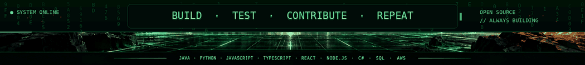

