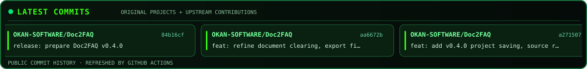
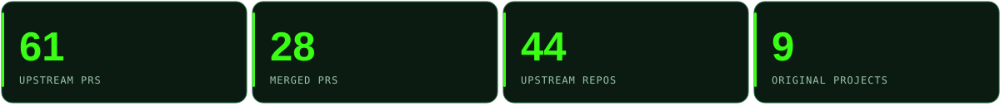
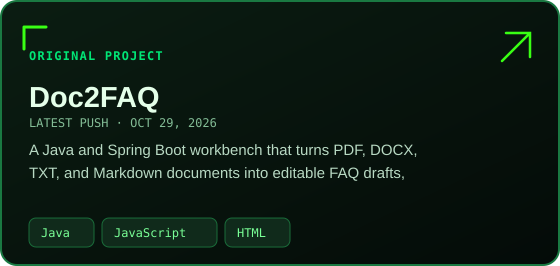
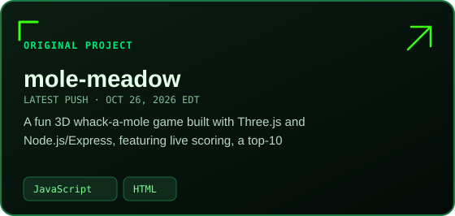
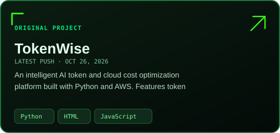
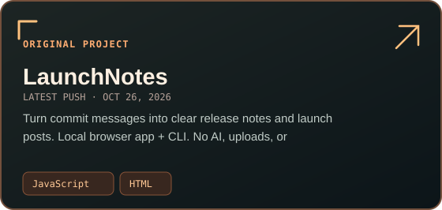
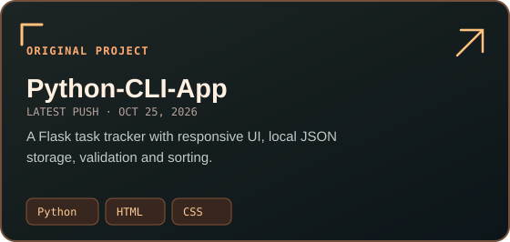
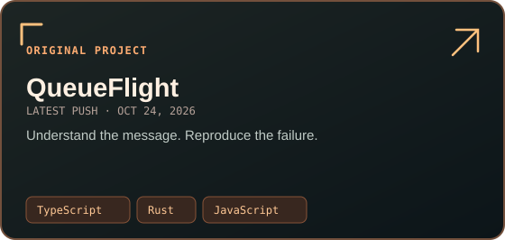
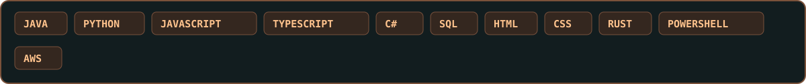

<!-- GITHUB-COMPATIBLE MATRIX DESIGN · No JavaScript or custom CSS in README -->

  

  

## Contribution Snake

  <picture>
    <source media="(prefers-color-scheme: dark)" srcset="./assets/contribution-snake-dark.svg" />
    <source media="(prefers-color-scheme: light)" srcset="./assets/contribution-snake.svg" />
    
  </picture>

The snake is generated daily from public contributions and uses Matrix-green animated SVGs.

---

## About

<table>
<tr>
<td width="60%" valign="middle">
  <h2>Building software that <em>solves real problems.</em></h2>
  
I'm <strong>Okan Tiktas</strong>, a software engineer working across backend services, web applications, automation, developer tools, and open source.

  
I like turning recurring problems into dependable tools, reproducing difficult bugs, and adding tests that keep them fixed.

  
<strong>Build → Test → Contribute.</strong>

</td>
<td width="40%" valign="middle">
  
</td>
</tr>
</table>

## Tools built around real needs

Practical projects I built and maintain, ordered by **most recently updated**. These are **my original repositories**, not forks.

<!-- MATRIX_PROJECTS:START -->
Automatically sorted by latest push · Original public repositories only · Up to three source languages per card

| | |
| :--- | :--- |
|  |  |
|  |  |
|  |  |

<a href="https://github.com/OKAN-SOFTWARE?tab=repositories"><strong>Browse all original projects ↗</strong></a>

<!-- MATRIX_PROJECTS:END -->

## Open Source Field Notes

I contribute focused bug fixes, regression tests, CI improvements, and documentation to upstream projects. The counts below distinguish PRs opened, merged, and still under review.

<!-- ACTIVITY:START -->
**Last profile update: Oct 31, 2026 at 12:53 AM EDT**

**61 opened · 28 merged · 30 open now · 44 upstream repositories**

### Latest upstream work

| State | Contribution | Repository |
| :--- | :--- | :--- |
| 🟣 Merged | [fix(prompt-engine): prevent duplicate nested architectural decisions · #203](https://github.com/PicadoLabs/build-with-ai/pull/203) | [PicadoLabs/build-with-ai](https://github.com/PicadoLabs/build-with-ai) |
| 🟢 Open | [Fix false uninitialized variable diagnostic for dataclass KW\_ONLY separator · #11944](https://github.com/microsoft/pyright/pull/11944) | [microsoft/pyright](https://github.com/microsoft/pyright) |
| 🟢 Open | [fix(builder): close source stream after decoding error (#3404) · #3459](https://github.com/pylint-dev/astroid/pull/3459) | [pylint-dev/astroid](https://github.com/pylint-dev/astroid) |
| 🟢 Open | [fix(win32): correct SetCursorPos argument types (#1745) · #1750](https://github.com/java-native-access/jna/pull/1750) | [java-native-access/jna](https://github.com/java-native-access/jna) |
| 🟢 Open | [fix(mysql): reset popped state when re-pushing queue messages (#1777) · #1784](https://github.com/conductor-oss/conductor/pull/1784) | [conductor-oss/conductor](https://github.com/conductor-oss/conductor) |
| 🟢 Open | [fix(html): exclude custom bundler from worker configuration · #1204](https://github.com/nodejs/doc-kit/pull/1204) | [nodejs/doc-kit](https://github.com/nodejs/doc-kit) |
| 🟢 Open | [fix(client): support accountId in assignable project searches · #2449](https://github.com/pycontribs/jira/pull/2449) | [pycontribs/jira](https://github.com/pycontribs/jira) |
| 🟢 Open | [test: isolate Django cache settings between xdist worker groups · #852](https://github.com/jazzband/django-redis/pull/852) | [jazzband/django-redis](https://github.com/jazzband/django-redis) |
| 🟢 Open | [fix: avoid stale dependency comparisons during snapshot retries · #1179](https://github.com/actions/dependency-review-action/pull/1179) | [actions/dependency-review-action](https://github.com/actions/dependency-review-action) |
| 🟢 Open | [fix: improve diagnostics for missing Linux libraries · #1656](https://github.com/actions/setup-node/pull/1656) | [actions/setup-node](https://github.com/actions/setup-node) |

[Explore open upstream PRs →](https://github.com/pulls?q=is%3Apr+is%3Apublic+author%3AOKAN-SOFTWARE+-user%3AOKAN-SOFTWARE+is%3Aopen+sort%3Aupdated-desc) · [Merged upstream PRs →](https://github.com/pulls?q=is%3Apr+is%3Apublic+author%3AOKAN-SOFTWARE+-user%3AOKAN-SOFTWARE+is%3Amerged+sort%3Aupdated-desc)

The upstream counters record PR openings and merges—not commits or fork creation. The open count includes drafts across all dates. Private work and my own repositories are excluded. Counts do not imply approval or passing CI. [How this updates](./PROFILE.md)

<!-- ACTIVITY:SNAPSHOT:db18a16b5e67fbbe751b4fd38beb132b99539ba13d167225db67c5fdc62dd1a0 -->
<!-- ACTIVITY:END -->

## Recent Activity

Automatically refreshed · Latest public action per repository · No timestamp column

<!-- RECENT:START -->
| Recent activity | Details |
| :--- | :--- |
| Forked repository in [littlebearapps/plainspoken](https://github.com/littlebearapps/plainspoken) | Public fork |
| Opened PR in [OKAN-SOFTWARE/OKAN-SOFTWARE](https://github.com/OKAN-SOFTWARE/OKAN-SOFTWARE) | [Pull request](https://github.com/OKAN-SOFTWARE/OKAN-SOFTWARE/pull/22) |
| Forked repository in [ancaferro/myPhotos](https://github.com/ancaferro/myPhotos) | Public fork |
| Commented in [aws-cloudformation/cfn-lint](https://github.com/aws-cloudformation/cfn-lint) | [fix\(E1011\): report bad Fn::FindInMap keys in unconstrained positions](https://github.com/aws-cloudformation/cfn-lint/issues/4919) |
| Opened PR in [pylint-dev/astroid](https://github.com/pylint-dev/astroid) | [Pull request](https://github.com/pylint-dev/astroid/pull/3459) |
| Opened PR in [java-native-access/jna](https://github.com/java-native-access/jna) | [Pull request](https://github.com/java-native-access/jna/pull/1750) |
| Opened PR in [conductor-oss/conductor](https://github.com/conductor-oss/conductor) | [Pull request](https://github.com/conductor-oss/conductor/pull/1784) |
| Commented in [nodejs/doc-kit](https://github.com/nodejs/doc-kit) | [fix\(html\): exclude custom bundler from worker configuration](https://github.com/nodejs/doc-kit/issues/1204) |
<!-- RECENT:END -->

## Languages & Toolkit

| Focus | Technologies |
| :--- | :--- |
| **Backend** | Java · Python · C# · JavaScript/TypeScript · Node.js · Express · Spring Boot |
| **Frontend** | React · JavaScript · TypeScript · HTML · CSS · Three.js |
| **Data** | SQL · PostgreSQL · SQL Server · SQLite · MongoDB · DynamoDB |
| **Cloud & delivery** | AWS Lambda · SQS · SNS · EventBridge · EC2 · GitHub Actions · Docker |
| **Testing** | pytest · JUnit · Vitest · automated regression testing |

<strong>Explore Code DNA, commit patterns, and more development statistics</strong>

<!-- JOURNEY:START -->
**Developer stats refreshed:** Oct 31, 2026 at 12:53 AM EDT

### 🧬 Code DNA · Public GitHub History

**80 authored commits · 9 public original repositories**

#### 🕒 When I Commit

| Time of day (Eastern) | Commits | Share | Activity |
| :--- | ---: | ---: | :--- |
| 🌞 Morning | 38 | 47.5% | ████████░░░░░░░░ |
| 🌆 Daytime | 37 | 46.2% | ███████░░░░░░░░░ |
| 🌃 Evening | 5 | 6.2% | █░░░░░░░░░░░░░░░ |
| 🌙 Night | 0 | 0.0% | ░░░░░░░░░░░░░░░░ |

#### 💬 I Mostly Code in JavaScript

| Language | Line of Codes | Source bytes | Activity |
| :--- | ---: | ---: | :--- |
| JavaScript | 273,411 | 16,944,094 | ████████████████ |
| Java | 1,603 | 81,259 | ░░░░░░░░░░░░░░░░ |
| Python | 1,377 | 68,902 | ░░░░░░░░░░░░░░░░ |
| HTML | 731 | 51,076 | ░░░░░░░░░░░░░░░░ |
| TypeScript | 1,128 | 12,729 | ░░░░░░░░░░░░░░░░ |
| Rust | 44 | 2,148 | ░░░░░░░░░░░░░░░░ |
| Dockerfile | 9 | 351 | ░░░░░░░░░░░░░░░░ |

### 🧩 My Development Stack

| Area | Technologies |
| :--- | :--- |
| **Backend** | Java · Python · C# · JavaScript/TypeScript (Node.js) · Express · Spring Boot |
| **Frontend** | JavaScript · TypeScript · React · HTML · CSS · Three.js |
| **Data & SQL** | SQL · PostgreSQL · SQL Server · SQLite · MongoDB · DynamoDB |
| **OS & DevOps** | Windows · Ubuntu/WSL · GitHub Actions · Docker |
| **Cloud** | AWS Lambda · SQS · SNS · EventBridge · EC2 |
<!-- JOURNEY:END -->

