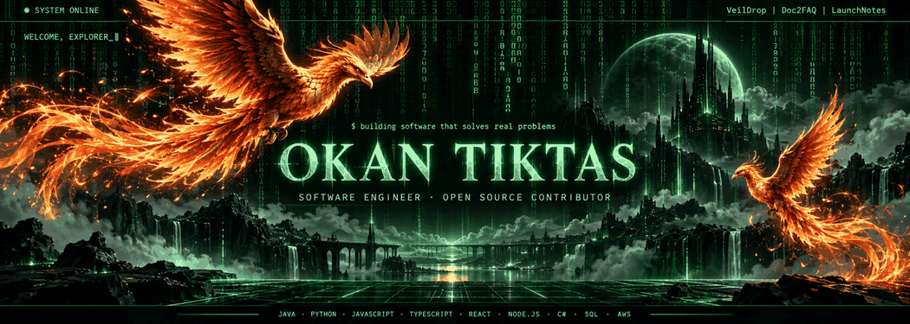
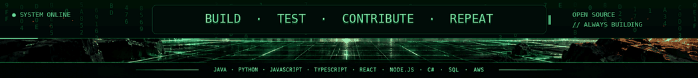

# Animated Phoenix README assets

Upload `phoenix-hero-animated.gif` and `phoenix-footer-animated.gif` into the `assets/` folder of `OKAN-SOFTWARE/OKAN-SOFTWARE`.

## Replace only the existing top hero image

Change this existing line:

```html

```

to:

```html

```

## Append this to the very bottom of README.md

```html
<p align="center">
  
</p>
```

Keep all existing profile text, activity automation markers, projects, contribution snake, and navigation buttons untouched. The text and links *inside* an animated GIF are not individually clickable. Use separate Markdown links for navigation.
